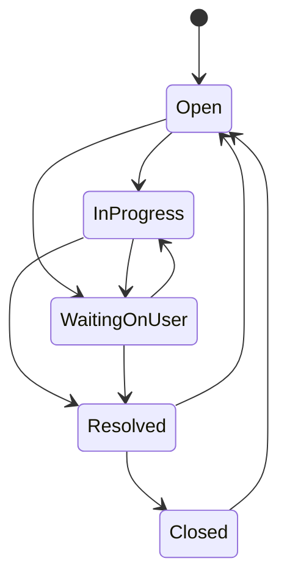

# DeskFlow — IT Service Desk and Ticket Management System

A complete, runnable learning and portfolio application for employee support requests,
agent ticket handling, and administrator oversight.

**Stack:** React 19 · Vite · JavaScript · Flask · Flask-Login · SQLAlchemy · MySQL / SQLite.

Start with **[START_HERE.md](START_HERE.md)** for a Windows-first walkthrough.
A production frontend build is included; Python packages must be installed on the target machine.

## Features

- Session login, logout, password changes, disabled accounts and session invalidation.
- Admin, Agent and Employee permissions enforced by the backend.
- Dashboard with active/overdue/unassigned counts, SLA compliance, resolution average,
  seven-day ticket activity and recent tickets.
- Ticket creation, search, category/priority/status filters, queue scopes and pagination.
- Assignment by admins; agents may claim unassigned tickets.
- Validated ticket state transitions with required resolution notes.
- Resolution deadlines by priority and overdue indicators.
- Public conversations and staff-only internal notes.
- Attachments with authenticated downloads, extension/signature checks and size limits.
- Ticket activity history and in-app notifications for requesters and assignees.
- Searchable knowledge articles; staff can create and edit articles.
- Admin user creation, editing, role changes, account disabling and password reset.
- Filtered CSV export for support staff, with spreadsheet formula escaping.
- Responsive interface, visible focus styles, labeled controls and feedback states.
- Database-backed login throttling, CSRF validation, password hashing and security headers.
- Generated demo passwords, explicit data initialization, no destructive reset script.

## Quick start

Python 3.10+ is supported; Python 3.12 is recommended. On Windows:

```powershell
py -3 scripts/setup.py --demo
py -3 scripts/start.py
```

On Linux/macOS:

```bash
python3 scripts/setup.py --demo
python3 scripts/start.py
```

Open **http://127.0.0.1:5000**. Use the credentials printed by setup.
Only the first setup needs `--demo`. Subsequent launches only need `start.py`.

## Role permissions

| Action | Employee | Agent | Admin |
| --- | --- | --- | --- |
| Create ticket | Yes | Yes | Yes |
| View ticket | Own requests | All | All |
| Add public reply / attachment | Own requests | All | All |
| Read / write internal notes | No | Yes | Yes |
| Change priority / resolve | No | Assigned to self | All |
| Claim unassigned ticket | No | Self only | Any staff member |
| Reassign / unassign | No | No | Yes |
| Close resolved ticket / reopen | Own requests | Assigned to self | All |
| Edit knowledge base | No | Yes | Yes |
| Export CSV | No | Yes | Yes |
| Manage users | No | No | Yes |

Employee close/reopen is available only from Resolved or Closed, as appropriate.
Comments and attachments remain available for follow-up even on closed tickets.
Staff can discuss any ticket, but only its assigned agent or an admin can change workflow fields.

## Ticket lifecycle and SLA



| Priority | Resolution target |
| --- | --- |
| Critical | 4 hours |
| High | 8 hours |
| Medium | 24 hours |
| Low | 72 hours |

The timer uses **elapsed UTC hours**, including nights and weekends. Waiting on User does
not pause it. A priority change recalculates the deadline from the original creation time.
Reopening retains that deadline. SLA compliance is the proportion of currently resolved/closed
tickets whose latest resolution time was on or before the deadline. It is a local project policy,
not an ITIL certification claim or a business-hours SLA engine.

## Repository structure

| Path | Purpose |
| --- | --- |
| backend/app.py | WSGI entrypoint |
| backend/servicedesk/__init__.py | App factory, sessions, CSRF, headers, errors |
| backend/servicedesk/models.py | SQLAlchemy data model |
| backend/servicedesk/api.py | JSON endpoints, authorization, workflow rules |
| backend/servicedesk/commands.py | Initialize DB, create admin, seed demo |
| backend/tests/ | API integration and security behavior tests |
| frontend/src/main.jsx | React pages and shared UI components |
| frontend/src/api.js | Session/CSRF-aware API client |
| frontend/src/styles.css | Responsive design system |
| frontend/dist/ | Built frontend served by Flask/Waitress |
| scripts/ | Cross-platform setup and local launch helpers |
| docs/ | Setup, architecture, API and validation notes |

Runtime data is stored in `backend/instance/` and is intentionally absent from the ZIP.
For SQLite, back up the database while the server is stopped, along with the uploads directory.
For MySQL, use your database backup tooling and separately back up uploads.

## Development mode

The Vite development server proxies `/api` to Flask, keeping browser API requests same-origin.
Node.js 20.19+ or a supported later release is recommended; Node 24 works for this project.

Backend terminal, from the project root on Windows:

```powershell
cd backend
.\.venv\Scripts\python.exe app.py
```

Frontend terminal:

```powershell
cd frontend
npm ci
npm run dev
```

Open **http://127.0.0.1:5173** for live frontend editing.
After frontend changes, run `npm run build` to update the bundled app used by `start.py`.
The source uses React JSX directly through Vite; no CDN, runtime npm download or API key is needed.

## Fresh installation without demo users

```powershell
py -3 scripts/setup.py
cd backend
.\.venv\Scripts\python.exe -m flask --app app create-admin
```

Enter your own name, email and private password at the prompts. Then launch normally.
`init-db` creates missing tables only. It does **not** migrate existing tables; when changing
models after initial use, plan a versioned schema migration rather than expecting `create_all`
to alter columns.

## Run tests

From `backend/` on Windows:

```powershell
.\.venv\Scripts\python.exe -m pip install -r requirements-dev.txt
.\.venv\Scripts\python.exe -m pytest -q
```

On Linux/macOS use `.venv/bin/python` in place of `.\.venv\Scripts\python.exe`.
Tests use isolated temporary SQLite databases and attachment directories.

## Scope and deployment

This is a locally runnable portfolio project. The launch helper binds to localhost.
For organizational deployment, configure HTTPS and `COOKIE_SECURE=true`, a managed
`SECRET_KEY`, private database credentials, backups, schema migrations, logging and monitoring.
Attachment checks do not include antivirus scanning. The current implementation has no SMTP,
SSO, self-service email password recovery, realtime push or external AI service.
Notifications appear in the app when their page is loaded. No background escalation job runs.
Dashboard metrics load the visible ticket set in memory; use SQL aggregation before large-scale use.

Development dependencies should be reviewed and updated regularly. Keep secrets, virtual environments,
real databases, and uploaded files out of Git. Do not expose the Vite development server publicly.

## Official references

- [Flask security considerations](https://flask.palletsprojects.com/en/stable/web-security/)
- [Flask-SQLAlchemy quick start](https://flask-sqlalchemy.palletsprojects.com/en/stable/quickstart/)
- [React documentation](https://react.dev/learn)
- [MySQL documentation](https://dev.mysql.com/doc/)
