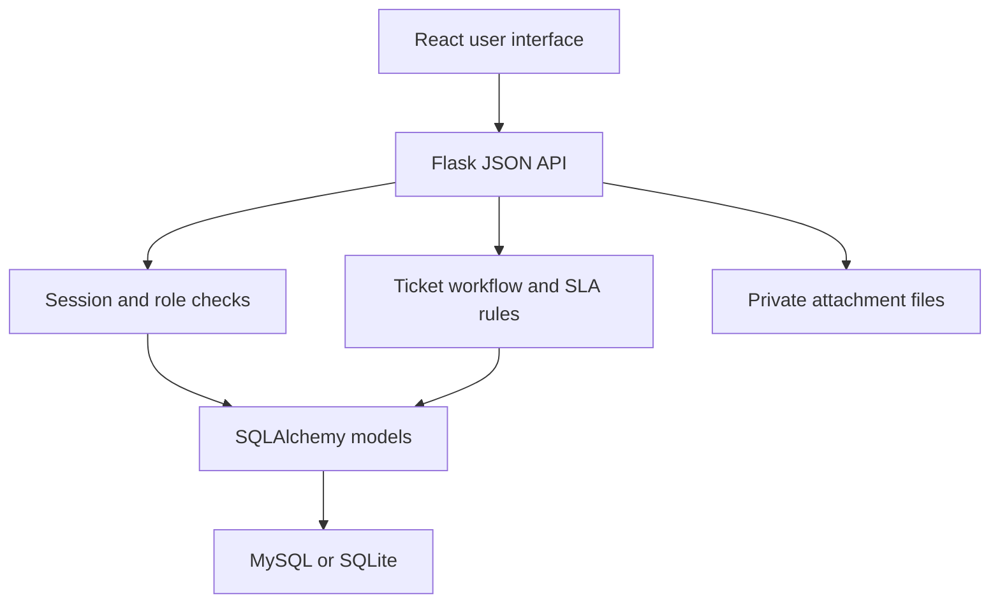
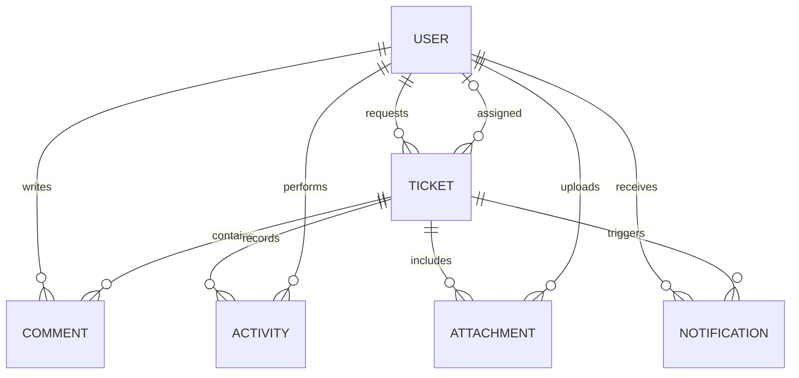

# Project explanation and demonstration guide

## Abstract

The IT Service Desk and Ticket Management System centralizes employee support requests.
It gives each issue a trackable identifier, priority, category, requester, owner, status,
and resolution deadline. Employees can follow progress, agents can collaborate and record
resolutions, and administrators can manage accounts and monitor the support queue.

The application uses a React interface, a Flask JSON API, and SQLAlchemy data models compatible
with MySQL and SQLite. Authentication, authorization, validation, concurrency checks and deadline
calculation happen on the server. The frontend presents each role's available actions.

## Problem and objectives

Informal support through calls and messages makes requests easy to lose, duplicates effort,
and leaves ownership unclear. This project aims to:

1. Capture requests consistently and preserve their history.
2. Make responsibility and progress visible to the right people.
3. Prioritize work and highlight overdue issues.
4. Separate employee access from staff and administrator privileges.
5. Reuse solutions through a searchable knowledge base.
6. Report queue health with transparent, reproducible metrics.

## Architecture

The development frontend uses a Vite proxy. In the bundled build, Flask/Waitress serves both
frontend assets and the API from the same origin. This avoids the need to put authentication
credentials into JavaScript storage or enable permissive cross-origin credentials.

## Database relationships

| Entity | Main fields | Purpose |
| --- | --- | --- |
| User | email, role, password_hash, active, session_version | Identity and access |
| Ticket | title, status, priority, requester_id, assignee_id, due_at, version | Support request and lifecycle |
| Comment | ticket_id, author_id, body, internal | Public replies and private staff notes |
| Activity | ticket_id, actor_id, message, created_at | Ticket event history |
| Attachment | filename, storage_name, size, ticket_id | Authenticated file metadata |
| Notification | user_id, ticket_id, message, read | In-app updates |
| Article | title, category, body | Reusable support instructions |
| LoginAttempt | hashed key, created_at | Login abuse throttling |

Article and LoginAttempt are independent tables and intentionally omitted from the relationship
chart. Account changes are not logged in Activity; Activity is specifically a ticket history.

## Key implementation decisions

- **Server authorization:** hiding buttons is a convenience; the API validates role and ownership.
- **Password hashing:** passwords are never saved in plaintext. Demo passwords are generated at setup.
- **CSRF:** browser cookies are sent automatically, so write requests also carry a session-bound token.
- **Optimistic concurrency:** clients send a ticket version. SQLAlchemy also checks that version
  during the database update, preventing one agent from silently overwriting another.
- **Private files:** uploads use random storage names outside the frontend directory. Every download
  checks ticket access and is served as a download rather than executable inline content.
- **SLA clarity:** targets are elapsed hours, with no unimplemented business-calendar assumptions.
- **Database portability:** ORM models and queries are shared. Connection configuration chooses the engine.
- **Safe output:** React text rendering avoids HTML injection; CSV exports escape formula-like values.

## Seven-minute demonstration

1. **Admin, 1 minute:** sign in and explain active tickets, SLA overdue and queue health.
2. **Employee, 1 minute:** use a separate browser profile/private window, create a Network ticket,
   and upload a harmless TXT file or screenshot. Show that another employee cannot see it.
3. **Admin, 1 minute:** search the ticket number and assign the ticket to the support agent.
4. **Agent, 2 minutes:** change Open → In Progress, add a public reply and an internal diagnostic note,
   then resolve with a meaningful summary. Switch to Employee to demonstrate note privacy.
5. **Employee, 1 minute:** view the reply, download the attachment, and close the resolved ticket.
6. **Admin, 1 minute:** show ticket activity, filtered CSV export, knowledge articles, and People.

Avoid displaying generated passwords, database credentials, or real sensitive uploads in recordings.

## Interview / viva questions

**What does your project do?**
It centralizes IT support requests and tracks their lifecycle from creation to resolution,
with role-based access, assignment, service deadlines, collaboration and reporting.

**Why Flask and React?**
Flask provides a focused Python API that is easy to structure and test. React manages interactive
forms and views. Their JSON boundary separates presentation from workflow and database logic.

**How do you prevent one employee from reading another's tickets?**
The API filters list and dashboard queries by requester ID and rechecks ownership for ticket
details, comments and downloads. Unauthorized ticket IDs return 404.

**Authentication vs authorization?**
Authentication identifies the signed-in user. Authorization decides whether that user may perform
a specific action on a particular ticket or account.

**Why hash passwords?**
The server verifies a password against a one-way salted hash, so the database does not need the
original password. Werkzeug's password helper handles the hash format and verification.

**What happens if two agents edit at once?**
The ticket has a version number. The API and ORM reject stale updates with HTTP 409, requiring a
refresh instead of accepting an accidental overwrite.

**How are SLA deadlines calculated?**
Creation time plus the priority target in UTC. Overdue means an unresolved ticket has passed its
deadline. Reopening retains the original deadline. This version does not pause for weekends or waiting.

**How are internal notes private?**
Only staff may create them, and the backend excludes them from employee ticket responses and
requester notifications. The UI is not the security boundary.

**How would you scale it?**
Use indexed SQL aggregations for dashboards, database-backed search, managed object storage,
background notification workers, migrations, monitoring, backups and trusted identity integration.
Add capacity based on measured load; no large-scale performance claim is made for this version.

**What have you tested?**
See TEST_REPORT.md. Distinguish automated SQLite/API verification from the MySQL and browser checks
that still need to be run in the target environment.

## Future enhancements

Business-hours SLA calendars and escalation jobs; email notifications and password recovery;
SSO and MFA; malware scanning; approval workflows; incident/problem/change management;
asset inventory integration; realtime updates; analytics aggregated directly in SQL.

These are proposed extensions, not features represented as implemented in this ZIP.
